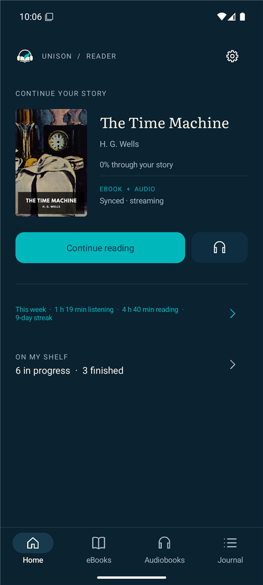
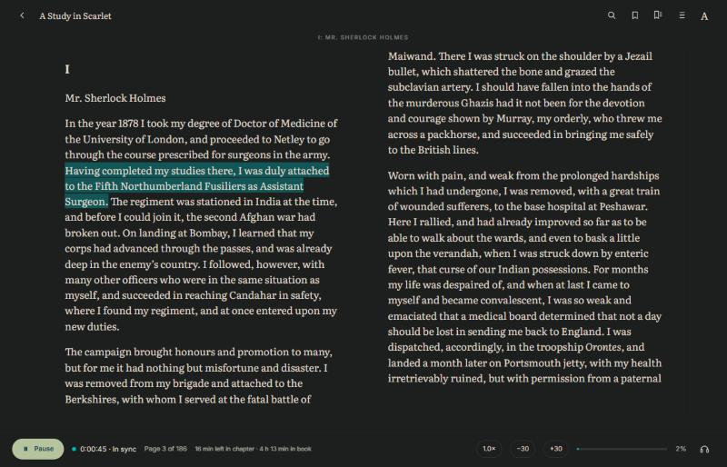
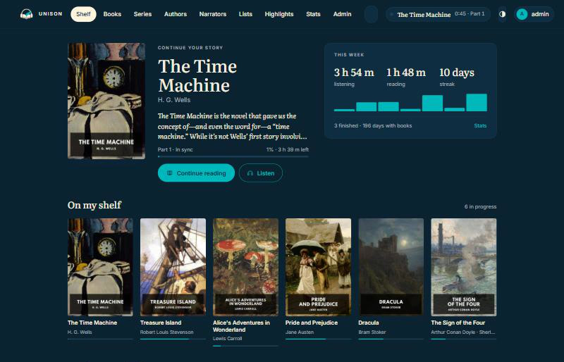
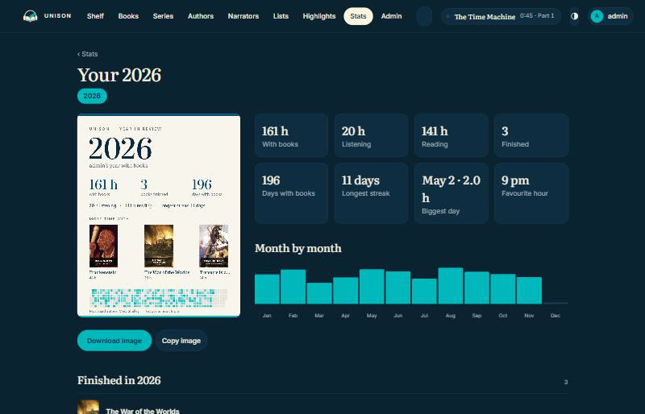

# UnisonReader

[](https://github.com/wandering-wampa/unison-reader/actions/workflows/test.yml)

An Android app, a server and a web client for reading an ebook and listening to its audiobook as the same book. The server works out when each sentence of the ebook is spoken in the audiobook. Once it has, the reader highlights the sentence being narrated and keeps the page with it, and you can stop listening and read on from that sentence.

I built it for my own household's library and it's shared as it is. The [Status](#status) section lists what's missing for anyone else.

<p align="center">
  
  
  
  
  
</p>

## How it works

You point the server at two folders: a folder of ebooks (a Calibre library, or just EPUB files) and a folder of audiobooks. It reads them and never writes to either. It matches each audiobook to its ebook by title, author and series. The ones it can't match show up in a list, and an admin pairs them by hand.

For each pair, the server runs the audio through an English speech model and lines the output up against the book's text, so narration follow is for books in English. That gives a start and end time for nearly every sentence. A thirty-hour audiobook takes about twenty minutes on a six-core laptop processor. Where the model can't place a sentence it leaves it unmatched. There is no guessing from page position or elapsed time.

In the app or the web reader, open the book and press Listen here on any page. Narration starts from that page, the spoken sentence is highlighted, and the page keeps up. Pause and you're looking at the sentence you just heard.

Your place lives on the server, one per person. Read on the phone, then open the book in a browser, and it's at the same sentence. If two devices have both moved since they last synced (a phone that was offline, say), you're shown both places and asked which to keep. Nothing jumps on its own.

<p align="center">
  
  
</p>

## The pieces

- The Android app reads EPUBs in the publisher's layout, plays audiobooks, follows narration and keeps books for offline use. In a car it shows up in Android Auto with your shelf, recent books and series, and it answers "play … on Unison".
- The web client is the same library, reader and player in a desktop browser. The server serves it; there's nothing extra to install.
- The Wear OS app plays the audiobooks on your shelf from the watch itself, streamed or downloaded, over Wi-Fi or LTE. It's new and has had very little use on a real watch.
- The server is a Kotlin service with a SQLite database, run in Docker. Each person signs in and gets their own shelf, places, bookmarks, highlights and collections. An admin adds people, fixes pairings and corrects a wrong title or cover without touching the files.

Two smaller things. People can ask for books the library doesn't have, and the request is marked as arrived when the book turns up. Reading and listening time is counted per person, with streaks and a one-page review of the year that you can save as a picture.

<p align="center">
  
</p>

The screenshots come from a demo library of public-domain books (Standard Ebooks editions, two with LibriVox recordings) and a made-up year of reading. `Start-LocalServer.ps1 -Demo` builds the same library, if you want to see narration follow before pointing it at your own books.

## Status

It's in daily use here. For anyone else it's early. Before you spend an evening on it:

- The server runs from a published Docker image for x86-64 and ARM64. ARM64 has been started under emulation but not run on real hardware.
- Ebooks are read as EPUBs only. MOBI and AZW3 files are skipped, and a Calibre library is read from its `metadata.db` when there is one.
- Narration follow is for English books. Other languages read and play fine, but their sync ends as failed and says how little of the text matched.
- The app needs Android 15 or later and is sideloaded. The APKs are debug-signed builds, not store releases.
- Sign-in is a password. It's throttled and logged, but there's no second factor, so think before you put a server on the open internet.
- The web client is laid out for desktop browsers, and it loads its font from Google Fonts.
- Looking a book up, to ask for it or to fix its details, sends the words you typed to Audible's catalogue and Open Library.

## What you need

- Ebooks as EPUB files in a folder, either a Calibre library (the folder with `metadata.db` in it) or any folder of EPUBs.
- Audiobooks in `Author/Title/` folders, which is how Audiobookshelf lays them out. M4B, MP3 and the other common formats work. Narration follow needs the book to be in English.
- A machine that runs Docker with the Compose plugin, with both folders mounted read-only. Calibre and Audiobookshelf don't need to be running.
- An Android 15 or later phone for the app, or just a desktop browser.

## Running the server

1. Make an empty folder, open a terminal in it and download the two files (in Windows PowerShell, type `curl.exe` in place of `curl`):

   ```sh
   curl -fsSLO https://raw.githubusercontent.com/wandering-wampa/unison-reader/main/server/deploy/compose.yaml
   curl -fsSL https://raw.githubusercontent.com/wandering-wampa/unison-reader/main/server/deploy/.env.example -o .env
   ```

2. In `.env`, set `UNISON_AUDIOBOOKS` and `UNISON_EBOOKS` to your two folders. On Windows write them with forward slashes, such as `C:/Books/audiobooks`.
3. In that folder, run `docker compose up -d`. The first run pulls the image, about 340 MB.
4. Open `http://<host>:8095` in a browser. A new server has no password: the page shows what it found in the two folders and asks you to choose the admin password. If you open it from outside your own network it also asks for a key, which is the contents of `data/token` beside `compose.yaml`, so a stranger can't get there first. The key stops working once the setup is done.

This needs the Compose plugin (the command is `docker compose`, not `docker-compose`). On Linux, `docker` may need `sudo` or membership of the `docker` group. If port 8095 is taken, set `UNISON_PORT` in `.env`. Other machines can reach the server only if the host's firewall lets that port through. The first scan keeps adding books for a while after the page opens, so the library fills in over the next minutes.

To build the image yourself instead, run `docker build -t unisonserver:local .` in a clone of this repository and set `UNISON_IMAGE=unisonserver:local` in `.env`.

[The server guide](docs/SERVER.md) covers the settings, the first sign-in, updating and putting a reverse proxy in front of it.

## Download

The APKs are on the [Releases page](https://github.com/wandering-wampa/unison-reader/releases/latest): `UnisonReader-<version>.apk` for the phone and `UnisonReader-wear-<version>.apk` for a Wear OS watch. Open the file on the device, or run `adb install -r UnisonReader-<version>.apk` from a computer. Installing over an older version keeps your books and places. Each release lists the SHA-256 of both files.

## Documentation

- [Running the server: setup, settings, design, API](docs/SERVER.md)
- [Building the apps and the server](docs/BUILD.md)
- [How the alignment works](docs/ALIGNMENT.md)
- [Testing](docs/TESTING.md)
- [Changelog](CHANGELOG.md)
- [Third-party licences](docs/THIRD_PARTY.md)

## Licence

MIT, see [LICENSE](LICENSE). The libraries, fonts and speech model it builds on keep their own licences, listed in [Third-party licences](docs/THIRD_PARTY.md).
