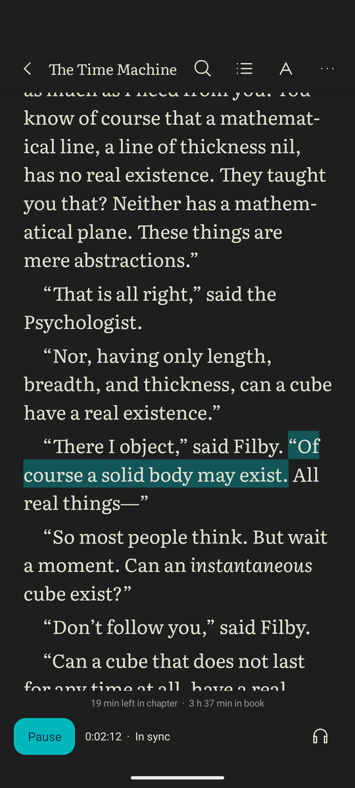
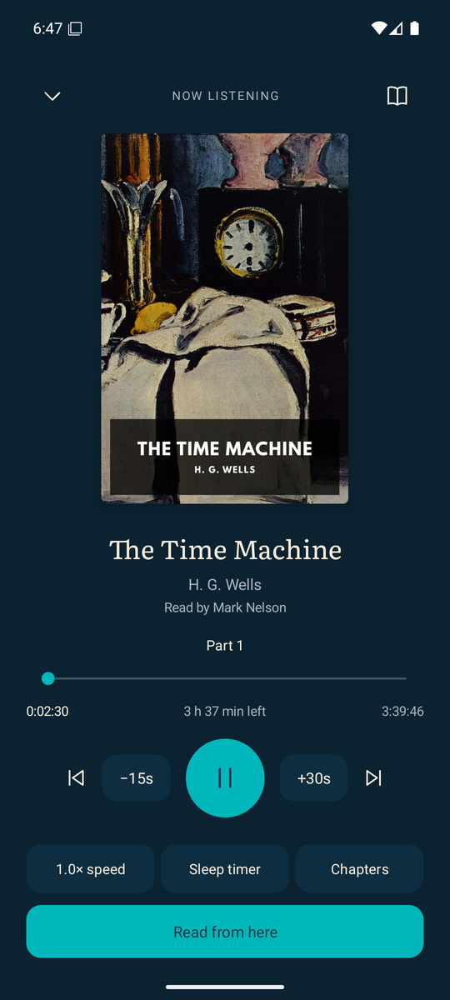
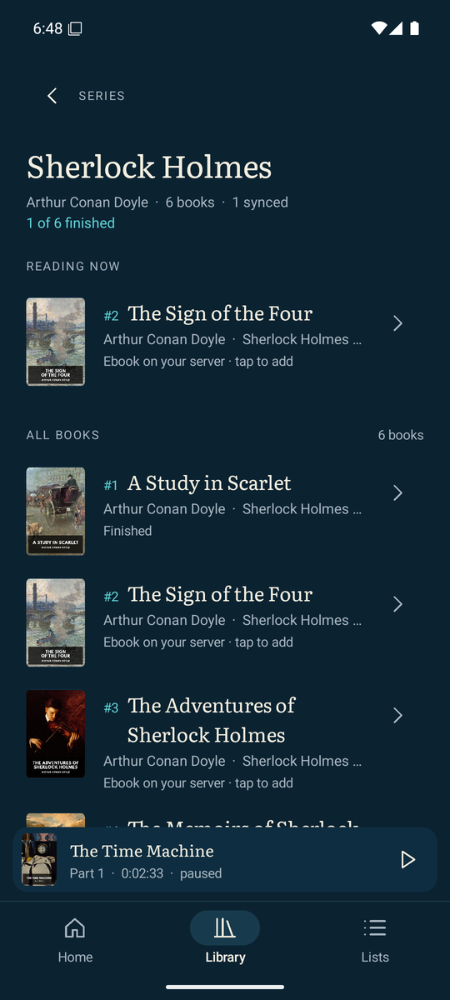
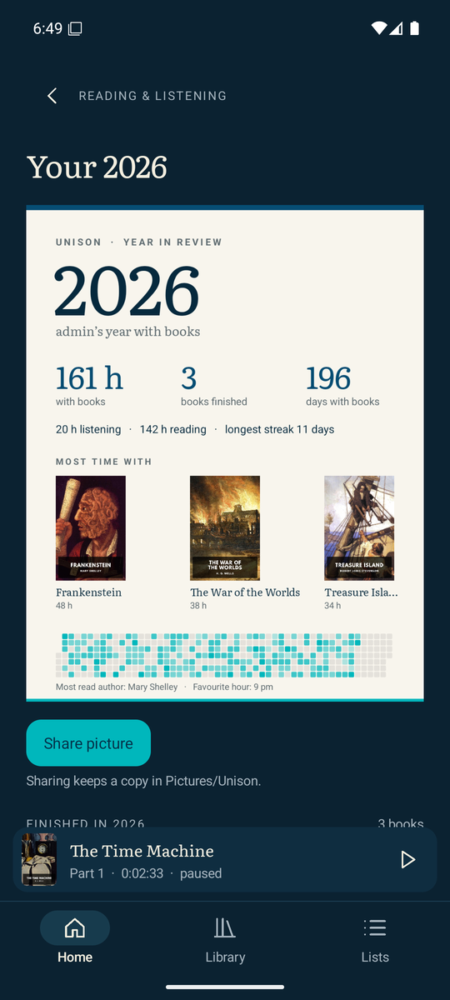

# UnisonReader

Read the book, listen to the audiobook, or do both at once. UnisonReader knows where every sentence falls in the narration, so the page follows the voice, and switching between reading and listening never loses your place.

It is self-hosted: an Android app, a server you run at home that holds the library and does the heavy work, and a web client. It was built for one household and is shared as it is.

  
  
  
  
  

## What it does

**The page follows the voice.** The server listens to each audiobook with a speech model and works out when every sentence of the ebook is spoken. In the reader, the sentence being narrated is highlighted and the text moves with it, in the book's own layout. Press Listen here on any page and the narration starts from that page; stop listening and you are on the right page to keep reading. Sentences the model could not place are left unmatched, never guessed.

**Your place is one place.** Read on the phone at lunch, listen in the car, pick the book up in a browser at night: it opens where you stopped, whichever way you got there. If two devices have moved the same book apart (a phone that was offline, say), nothing jumps: you are shown both places and asked which to keep.

**It runs on the library you already have.** UnisonServer reads a Calibre library and a folder of audiobooks exactly as they are and never writes to either. It pairs each ebook with its audiobook by title, author and series, syncs the pair in the background, and tells you which books are ready, which are still syncing and which are missing a half. When a title or cover is wrong, an admin corrects it in Unison (with a lookup to fill in the details) and the files stay untouched.

**It is for a household.** Each person signs in and has their own shelf, places, bookmarks and highlights, collections, and reading statistics. An admin adds people, pairs the books the scanner could not, and sees what the server is doing. There is a shared wanted list for books the library does not have yet; it marks a request as arrived when the book turns up.

**Phone, car and browser.** The Android app reads, plays and keeps books for offline use. In the car it appears in Android Auto with your shelf, recent books and series, and answers "play … on Unison". The web client is the same library, player and reader in a desktop browser, with narration follow, served by your own server.

  
  

**A record of your reading.** Listening and reading time are counted per person in their own time zone, with streaks, and each year ends in a one-page review you can share as a picture.

  

The pictures show the demo library that `Start-LocalServer.ps1 -Demo` builds: public-domain books in their Standard Ebooks editions, two of them with LibriVox recordings, and a year of made-up reading.

## Pieces

- **UnisonReader**, the Android app.
- **UnisonServer**, a small service in Docker. It reads the Calibre and audiobook folders without changing them, pairs ebooks with audiobooks, aligns them, and serves everything to the app and the web.
- **The web client**, served by UnisonServer at its address.
- **Unison for Wear OS**, a watch app that plays the server's audiobooks on its own, streamed or downloaded, and keeps the same place as the phone and the browser. Wear OS 6 and later.

## What you need

- **An ebook library that Calibre manages** (its folder with `metadata.db`). EPUBs are read.
- **A folder of audiobooks** laid out `Author/Title/`, the way Audiobookshelf keeps them (M4B, MP3 and the other common formats).
- **A machine that runs Docker**, with both folders mounted read-only. Neither Calibre nor Audiobookshelf has to be running.
- **An Android 15 or later phone** for the app. The web client needs only a desktop browser.

There is no published Docker image yet: the server is built from this repository and shipped to the host by a script. [UnisonServer](docs/SERVER.md) has the steps, the settings, the first sign-in, and what to put in front of it to reach it from outside the house.

## Download

The current apps are on the [Releases page](https://github.com/wandering-wampa/unison-reader/releases/latest): `UnisonReader-<version>.apk` for the phone and `UnisonReader-wear-<version>.apk` for a Wear OS watch. Open the file on the phone, or from a computer run `adb install -r UnisonReader-<version>.apk`. Installing over an older version keeps the library and positions. They are debug-signed builds for sideloading, not store releases. From 0.9.0 the app is about 25 MB and reads and listens from a UnisonServer: importing files and syncing on the phone itself are no longer in the default build (see [Build and install](docs/BUILD.md) for the standalone build). The release notes carry the SHA-256 of each file.

## Documentation

Everything technical is in [`docs/`](docs/):

- [UnisonServer: running it, settings, design, API](docs/SERVER.md)
- [Build and install](docs/BUILD.md)
- [How the alignment works](docs/ALIGNMENT.md)
- [Testing](docs/TESTING.md)
- [Third-party licences](docs/THIRD_PARTY.md)

## Licence

UnisonReader, UnisonServer and the web client are under the [MIT licence](LICENSE). The libraries, fonts and speech model they build on keep their own licences, listed in [Third-party licences](docs/THIRD_PARTY.md).
